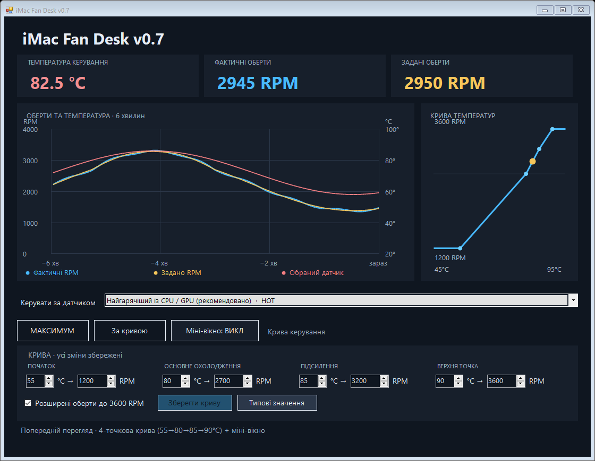

# iMac Fan Desk

**Fan control for Intel iMac on Windows.** A small Ukrainian-language desktop app with a temperature tray icon, editable fan curve, live charts and a floating temperature/RPM overlay.

[Download v0.7](https://github.com/maksimka991/iMac-Fan-Desk/releases/tag/v0.7.0) · [Report an issue](https://github.com/maksimka991/iMac-Fan-Desk/issues)

## Compatibility

Tested on **iMac18,3 (27-inch, 2017), Windows 10**. Other models and Windows versions are unverified. Requires .NET Framework 4.x and the bundled x86 InpOut32 bridge. This is an experimental community utility, not an Apple product.

The UI is currently in Ukrainian.

## Install and run

1. Download `iMac-Fan-Desk-v0.7.0-windows.zip` from Releases and extract the entire archive.
2. Keep `iMacFanDesk.exe` and `inpout32.dll` together. Run the application as administrator when needed to load the low-level driver.
3. Choose the temperature sensor and edit the four temperature/RPM pairs. Click **Зберегти криву** (Save curve) to apply changes.
4. Choose **За кривою** (Curve) or **МАКСИМУМ** (Maximum).

Closing the window keeps control running in the tray. To stop control and return to firmware Auto, choose **Вийти → системне Auto** from the tray menu.

### Optional Windows startup

Keep the extracted app in a permanent, administrator-protected directory. In Windows Task Scheduler, create an interactive task for your account: trigger **At log on**, delay 15 seconds, **Run with highest privileges**, action `iMacFanDesk.exe --tray`, and set **Start in** to the application directory. Use **Run only when user is logged on** so the tray icon is visible. The portable release does not silently create a task.

## Features

- Hottest of CPU/GPU, a specific sensor, or hottest available sensor.
- Editable four-point curve with linear interpolation and saved settings.
- Temperature in the system tray; optional draggable always-on-top overlay.
- Six-minute history: actual RPM, target RPM and temperature.
- Target write verification and maximum-target fallback for missing temperature readings.
- Single-instance application and automatic recovery after resume.

Default points: **55°C / 1200 RPM → 80°C / 2700 RPM → 85°C / 3200 RPM → 90°C / 3600 RPM**.

### Hardware limits and failure behavior

Extended mode permits target requests above the reported SMC maximum, up to 3600 RPM. It is experimental: **F0AH=3600 does not establish a safe sustained speed** for every fan. The checkbox controls this mode. The current defaults enable it; turn it off to clamp requests to the SMC-reported maximum. No F0Mx, F0Mn or PWM writes are made by the application.

Run only one fan controller at a time. The app stops RPMac processes when taking control. A process crash or forced termination can leave the previous manual target in SMC; there is currently no independent watchdog. Displayed RPM is telemetry, not proof of airflow or adequate physical cooling. Do not disable Windows security features to force a blocked driver to load.

## Settings and diagnostics

Files are stored in `%LOCALAPPDATA%\iMacFanDesk`: `curve.txt`, `sensor.txt`, `mode.txt`, `overlay.txt`, `state.txt`, `errors.log`, and `logs/`.

When reporting a problem, include your Mac model, Windows version, app version, reproduction steps and relevant log excerpts. Review logs for personal information before uploading them. Never upload credentials or private machine data.

## Build from source

On Windows, run `powershell -File build.ps1`. The script uses the .NET Framework C# compiler already included with Windows. Outputs go to `build/`; the SMC bridge is copied beside the executable.

`--self-test` verifies curve calculations, invalid input handling and sensor selection. It does not test physical cooling, the driver, or UI interactions. `--render-preview` creates an image using simulated readings without controlling SMC.

## v0.7

A clearer four-point curve editor, unsaved-change indicator, improved chart labels, and a less crowded layout. Fan-control behavior from v0.6 is preserved.

## License and credits

GPL-2.0-only. SMC code derives from [RPMac](https://github.com/golirt1/RPMAC), with Linux applesmc and smcFanControl attribution retained in [NOTICE](NOTICE). InpOut32 is a separate MIT-licensed component; see `third_party/InpOut32/LICENSE-MIT.txt` and the [upstream project](https://www.highrez.co.uk/downloads/inpout32/).
